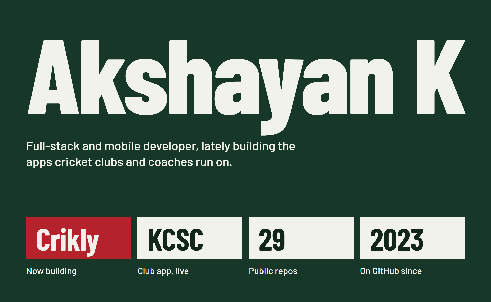
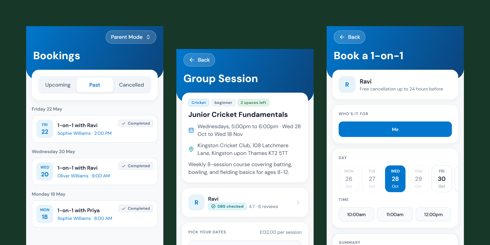
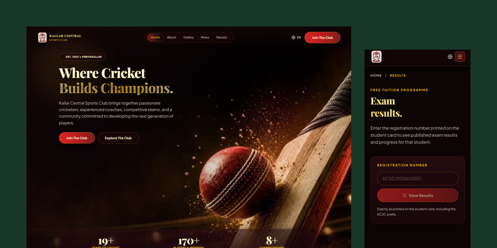
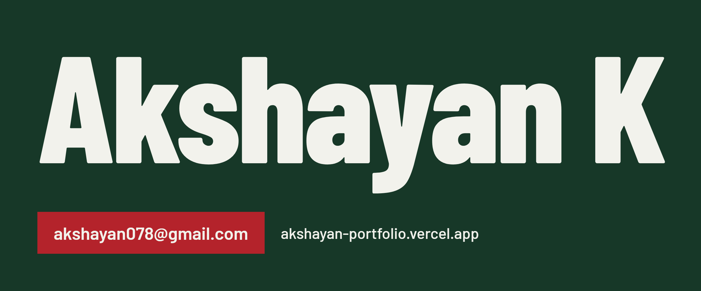

### Crikly: book a cricket coach

Players and parents find a coach, book one-to-one or group sessions and pay in the app, and coaches run their week from a workspace of their own. I'm building the two Expo apps and the Supabase backend behind them, with Stripe taking the payments. The code is private.

### Kallar Central Sports Club

A cricket club in Periyakallar, founded in 2007, that also runs free tuition for Grades 3 to 5. I built its website and admin console in Next.js and MongoDB, and a mobile app on the same API: QR student ID cards, attendance taken by scanning them, marks analysis, a results lookup for parents, and news and a gallery in Tamil and English.

[Visit the club's site](https://kcsc-web.vercel.app) · [Web app code](https://github.com/AkshayanAH112/KCSC-WebApp) · [Mobile app code](https://github.com/AkshayanAH112/KCSC-MobileApp)

### What I work with

Mostly TypeScript: React Native and Expo on phones, Next.js on the web, Supabase or MongoDB behind them, Stripe where money changes hands, Vercel to ship it. Java, Python, C++ and Dart when the job calls for them.

### Other projects

| Project | What it is | Built with |
| --- | --- | --- |
| [Portfolio](https://github.com/AkshayanAH112/Portfolio) | My portfolio site, [live here](https://akshayan-portfolio.vercel.app) | TypeScript |
| [kafka-avro-orders](https://github.com/AkshayanAH112/kafka-avro-orders) | Order events streamed through Kafka with Avro schemas | Python |
| [Vehicle Service Booking System](https://github.com/AkshayanAH112/Vehicle-Service-Booking-System) | Bookings for a vehicle service centre | TypeScript |
| [Saloon management system](https://github.com/AkshayanAH112/Saloon-management-system) | Appointments and staff for a salon | Dart, Flutter |
| [Pet adoption website](https://github.com/AkshayanAH112/Pet_Adoption_Website_Frontend) | Front end, with a separate [back end](https://github.com/AkshayanAH112/Pet_Adoption_Website_Backend) | JavaScript |
| [Movie review application](https://github.com/AkshayanAH112/movie-review-backend) | Reviews on a Java back end, with a separate [front end](https://github.com/AkshayanAH112/movie-review-frontend) | Java, JavaScript |
| [IoT home automation](https://github.com/AkshayanAH112/IoT-Home-Automation) | A sample home automation system | Java |
| [File compressor](https://github.com/AkshayanAH112/File-Compressor) | File compression built on a min-heap | C++ |

### Get in touch

Email me at [akshayan078@gmail.com](mailto:akshayan078@gmail.com), or see more of my work on [my portfolio](https://akshayan-portfolio.vercel.app).

