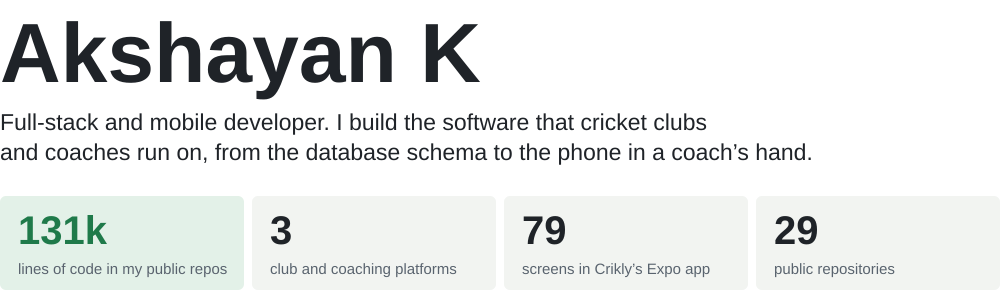
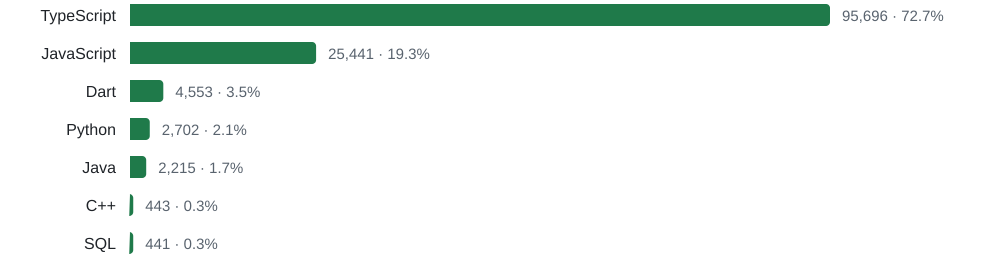
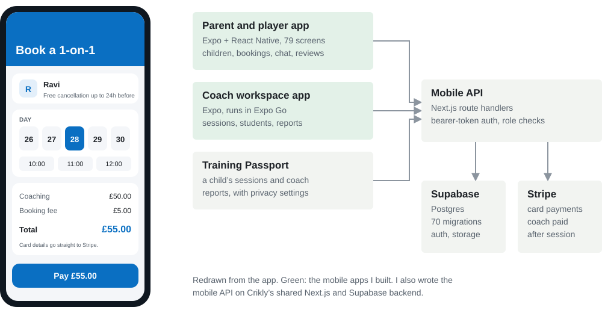
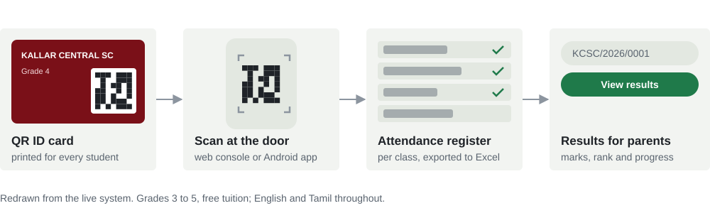
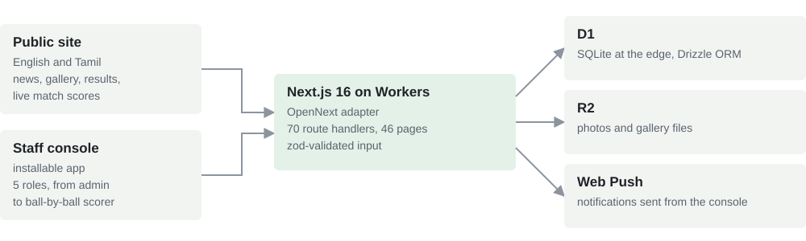
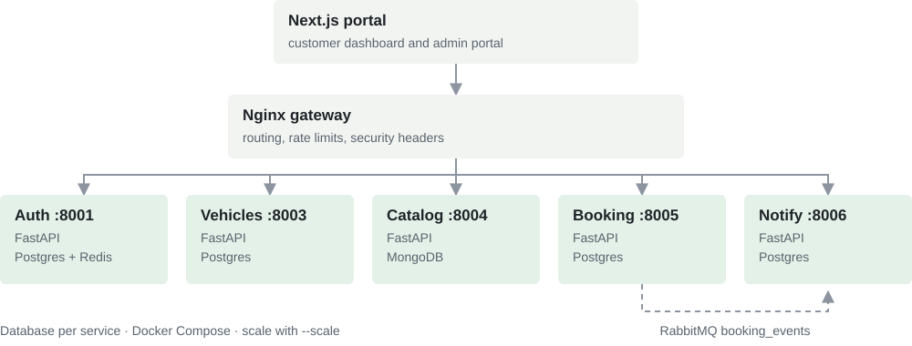
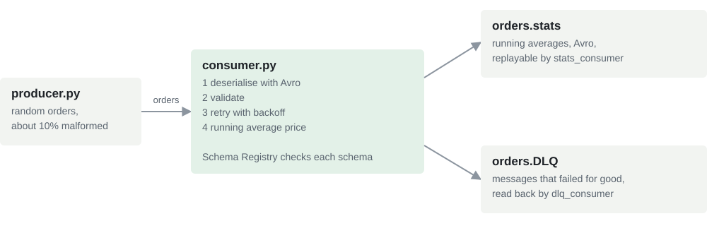

### What the code says I work in

Counted from the source files of my 20 public repos that have code, leaving out a team project and a duplicate. Styles, markup, config, lock files and builds are excluded, and the table below uses the same count.

Most of it is TypeScript on Next.js and React Native. Behind those sit MongoDB, Postgres through Supabase, or SQLite on Cloudflare D1. Python, Java, Dart and C++ show up where a course or a client called for them: FastAPI microservices, Kafka consumers, Spring Boot APIs, a Flutter app and a Huffman compressor.

### Crikly: book a cricket coach

Crikly connects parents and players with cricket coaches in the UK. Parents manage their children's profiles and bookings, players book for themselves, and coaches run their sessions from their own app. The web platform belongs to the team. I joined to build the **mobile side**:

- **The parent and player app.** Expo and React Native, 79 screens: children and their dates of birth, one-to-one and group bookings, chat, reviews, Google sign-in and a QR card.
- **The coach workspace app.** Sessions, students, booking actions and session reports, on real data.
- **Training Passport.** A child's session history and coach reports, with privacy settings for parents.
- **The mobile API.** Bearer-token auth, a player role, `/api/me`, and routes for events, chat, students, notifications and reviews, added to the shared Next.js and Supabase backend. Coaches can only see their own students.

The code is private.

### Kallar Central Sports Club

A cricket club in Periyakallar, founded in 2007, that also runs free tuition for Grades 3 to 5. I built the whole system: a Next.js 16 console and public site on MongoDB, plus an Android app for the people taking attendance.

- **Web app:** 27,400 lines of TypeScript, 62 API routes and 40 pages. It covers students and batches, QR attendance, exam marks with Excel import and export, analysis PDFs, news with a Tiptap editor, a gallery, club membership applications, cricket teams, tournaments and match scoring, and a job that moves students up a grade every 1 January. Two staff roles are enforced on the server, not just hidden in the UI.
- **Mobile app:** React and Vite wrapped in Capacitor for Android, 8,100 lines. It has no backend of its own and calls the web app's API with a bearer token. Scanning is its main job, and GitHub Actions builds the release APK.
- [The live site](https://kallarcentralsc.com) · [web app code](https://github.com/AkshayanAH112/KCSC-WebApp) · [mobile app code](https://github.com/AkshayanAH112/KCSC-MobileApp)

### Kavery Sports Club

The KCSC system ported to a second club in Periyaneelavanai and its education wing, then rebuilt for Cloudflare. At 41,900 lines of TypeScript, it's my largest repo.

The port changed the platform under the same product: MongoDB became D1 with Drizzle migrations, file storage moved to R2, and Web Push was added. The two KCSC roles grew into five (administrator, education manager, attendance marker, scorer and editor), each limited to its own work. The public site shows live match pages for every match, team, player and tournament. [Code](https://github.com/AkshayanAH112/Kavery-Web)

### Vehicle Service Booking System

A cloud computing assignment for the University of Ruhuna (EC7205): booking a car service, built as microservices.

Each service owns its database. Redis holds a blacklist of revoked JWTs, and booking events reach the notification service through RabbitMQ rather than a direct call. Customers book hourly slots between 08:00 and 17:00, and admins move each booking through confirmed, in progress and completed. [Code](https://github.com/AkshayanAH112/Vehicle-Service-Booking-System)

### Kafka and Avro order pipeline

An assignment for Applied Big Data Engineering (EC 8203): a stream of orders that must survive bad data.

Kafka runs in KRaft mode with Confluent's Schema Registry, and every message is Avro, including the failures. Temporary errors retry with backoff. Permanent ones go to a dead-letter topic with the failure type, the error, the attempt count and the source offset, and a FastAPI dashboard shows the pipeline live. Twelve pytest tests cover the aggregation, validation and retry logic. [Code](https://github.com/AkshayanAH112/kafka-avro-orders)

### Every public repository

| Repository | What it is | Built with | Size |
| --- | --- | --- | --- |
| [Kavery-Web](https://github.com/AkshayanAH112/Kavery-Web) | Club site, staff console and live cricket scoring for Kavery Sports Club | Next.js 16, Cloudflare Workers, D1, R2, Drizzle | 42.9k lines |
| [KCSC-WebApp](https://github.com/AkshayanAH112/KCSC-WebApp) | Admin console, API and public site for Kallar Central Sports Club, [live](https://kcsc-web.vercel.app) | Next.js 16, MongoDB, next-intl, Tiptap | 27.4k lines |
| [GlobalWingsCharity](https://github.com/AkshayanAH112/GlobalWingsCharity) | Student management for a charity: batches, attendance, marks, rankings and analytics for admins and teachers | Express, MongoDB, React, TypeScript | 15.7k lines |
| [KCSC-MobileApp](https://github.com/AkshayanAH112/KCSC-MobileApp) | Android app for QR attendance and marks, built by GitHub Actions | React, Vite, Capacitor | 8.1k lines |
| [Pet_Adoption_Website_Frontend](https://github.com/AkshayanAH112/Pet_Adoption_Website_Frontend) | Adoption site with a pet-matching quiz and printable adoption certificates | React, Material UI | 7.5k lines |
| [Saloon-management-system](https://github.com/AkshayanAH112/Saloon-management-system) | Salon booking app for clients, with opening hours, availability and a gallery for owners | Flutter, Express, MongoDB | 5.0k lines |
| [Vehicle-Service-Booking-System](https://github.com/AkshayanAH112/Vehicle-Service-Booking-System) | Five microservices behind an Nginx gateway, with RabbitMQ events | FastAPI, Next.js, Postgres, MongoDB, Redis | 4.1k lines |
| [Vaccancy-hub](https://github.com/AkshayanAH112/Vaccancy-hub) | Job board: employers post vacancies, job seekers search, apply and track status | MongoDB, Express, React, Node | 3.9k lines |
| [movie-review-frontend](https://github.com/AkshayanAH112/movie-review-frontend) | Movie reviews: browse, search, review, admin dashboard; served by nginx in Docker | React, Vite, Bootstrap | 3.4k lines |
| [kcsc-new-design](https://github.com/AkshayanAH112/kcsc-new-design) | Design prototype for the KCSC public site | React, Vite, Motion | 3.2k lines |
| [Cleaning-Management-System](https://github.com/AkshayanAH112/Cleaning-Management-System) | Booking cleaning services, with an admin dashboard of sortable tables | MongoDB, Express, React, Node | 2.4k lines |
| [Portfolio](https://github.com/AkshayanAH112/Portfolio) | My portfolio site, [live](https://akshayan-portfolio.vercel.app) | Next.js, Framer Motion | 2.4k lines |
| [movie-review-backend](https://github.com/AkshayanAH112/movie-review-backend) | REST API for the movie reviews, with JWT auth and Cloudinary posters | Spring Boot 3, Spring Security, MySQL | 1.7k lines |
| [Pet_Adoption_Website_Backend](https://github.com/AkshayanAH112/Pet_Adoption_Website_Backend) | API with admin, shelter and adopter roles; tested with Jest against an in-memory MongoDB | Express, MongoDB, Cloudinary | 1.4k lines |
| [kafka-avro-orders](https://github.com/AkshayanAH112/kafka-avro-orders) | Order stream with Avro, retries, a dead-letter queue and a live dashboard | Kafka, Schema Registry, Python, FastAPI | 1.4k lines |
| [Movie-Review-Application](https://github.com/AkshayanAH112/Movie-Review-Application) | The movie review app with CI/CD: Jenkins builds, images to AWS ECR, Terraform and Ansible deploy to EC2 | Jenkins, Docker, Terraform, Ansible | Combines the two movie repos |
| [MisSystem-Backend](https://github.com/AkshayanAH112/MisSystem-Backend) | Team project: a university results system with GPA and transcripts, built by seven people; I contributed a few commits | Spring Boot, PostgreSQL, Docker, Jenkins | Team |
| [MisSystem-Frontend](https://github.com/AkshayanAH112/MisSystem-Frontend) | Team project, forked: the front end of the same system, with transcripts laid out as A3 pages | React, Ant Design | Team |
| [File-Compressor](https://github.com/AkshayanAH112/File-Compressor) | Huffman coding text compressor with its own min-heap | C++ | 443 lines |
| [movie-review](https://github.com/AkshayanAH112/movie-review) | An early movies and reviews API | Spring Boot, MongoDB | 299 lines |
| [IoT-Home-Automation](https://github.com/AkshayanAH112/IoT-Home-Automation) | Client and server over TCP sockets, simulating smart lights, locks and sensors | Java, sockets, ConcurrentHashMap | 180 lines |
| [MRKT-AI](https://github.com/AkshayanAH112/MRKT-AI) | A Next.js starter, not built out yet | Next.js | 160 lines |
| [mylifesbirthday](https://github.com/AkshayanAH112/mylifesbirthday) | My first repository: one HTML page, from 2023 | HTML | 28 lines |
| [Stock-Prediction](https://github.com/AkshayanAH112/Stock-Prediction) | A placeholder; the project folder is empty | | |

Five more repositories are still empty: BigData-New-Assessment, Thiby-Constructions, furglo-professional, Project and Model-Repository.

### Get in touch

Email [akshayan078@gmail.com](mailto:akshayan078@gmail.com) or see [my portfolio](http://akshayank.com/).
